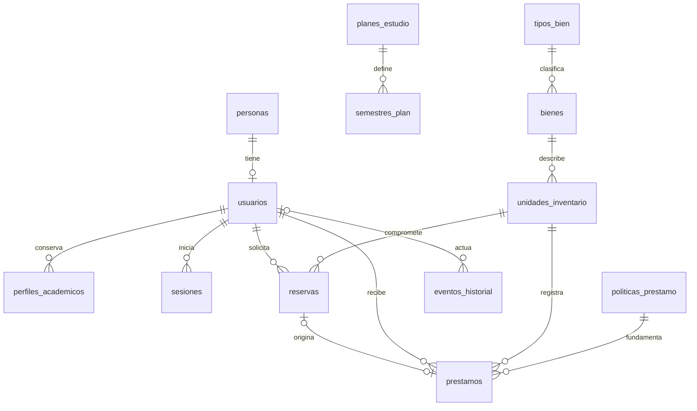

# Modelo MySQL: DBsistema_prestamos

Tablas InnoDB, caracteres utf8mb4, fechas UTC y BIGINT como cadenas en la API.
El nombre de la base se respeta con sus mayúsculas. Las tablas están en minúsculas.

| Tabla | Responsabilidad |
| --- | --- |
| personas | Identidad única, contacto y desactivación |
| usuarios | Cuenta única por persona, rol y atribución administrativa |
| perfiles_academicos | Estudiante/docente habilitado y código institucional sintético en demo |
| planes_estudio / semestres_plan | Semestres válidos por plan |
| sesiones | Hash del token, vencimiento y revocación |
| tipos_bien | Los cinco tipos permitidos |
| bienes | Fichas; ISBN no identifica un ejemplar |
| unidades_inventario | Ejemplar, código único, custodia, accesorios, condición y estado |
| alcances_politica | Filas estables para bloquear políticas por alcance |
| politicas_prestamo | Versiones general/rol y condiciones aprobadas |
| reservas | Intervalos futuros y ciclo de solicitud/decisión/atención |
| prestamos | Una unidad, responsable, condiciones históricas e inspección |
| eventos_historial | Eventos de solo adición, sin hashes ni tokens |
| schema_migrations | Versión, checksum y finalización del SQL aplicado |

## Reglas

- Una cuenta por persona, nombres de usuario/documentos/códigos únicos; bajas lógicas.
- Un semestre pertenece a un plan: no se impone un límite universal de 12.
- Una ficha puede tener varios ejemplares con el mismo ISBN.
- `prestamos.reserva_id` es único y su FK compuesta exige el mismo solicitante y unidad.
- `unidad_abierta` es una columna generada única: solo los préstamos abiertos
  aportan el identificador; los cerrados aportan NULL.
- Estados de reserva: pendiente, confirmada, rechazada, cancelada, atendida, vencida.
- Solo confirmada bloquea; pendiente no garantiza entrega. Se revalida al convertir.
- `v_prestamos_estado` deriva activo/vencido/devuelto y retraso del reloj.
- `v_disponibilidad_actual` muestra estado actual sin titulares. El endpoint de
  catálogo añade cálculo de intervalos sin divulgar otras reservas.
- La política aplicada al préstamo se conserva aunque después cambie otra versión.
- Los cambios de negocio generan eventos por triggers en la misma transacción.
- El editor gráfico no cambia préstamos, reservas ni contraseñas.

Los archivos SQL tienen un propósito por migración. Las rutinas usan DELIMITER
como Workbench. Si una migración queda parcial, el ejecutor rechaza continuar:
MySQL no admite rollback global de DDL. No cambiar un SQL ya aplicado.

El reformateo puramente visual de las primeras diez migraciones tiene una
compatibilidad acotada por pares SHA-256 exactos. Conserva el historial existente
sin reejecutar SQL. Ver [organización y compatibilidad](../backend/database/README.md).

El [diccionario de datos](diccionario-datos.md) describe las columnas y sus dominios.
